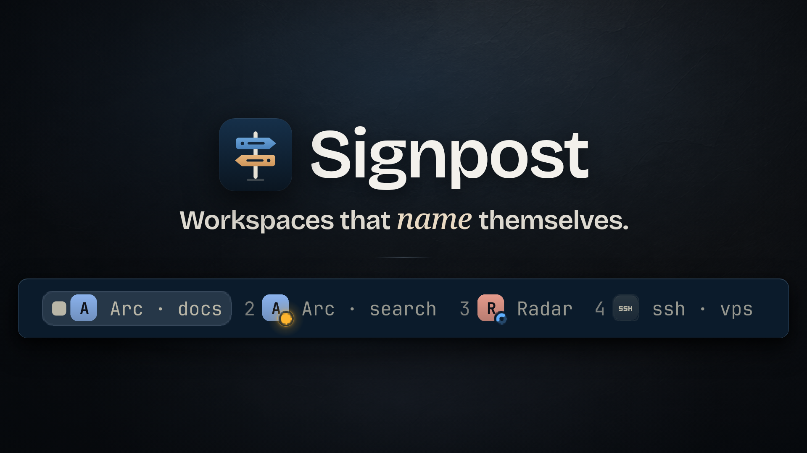
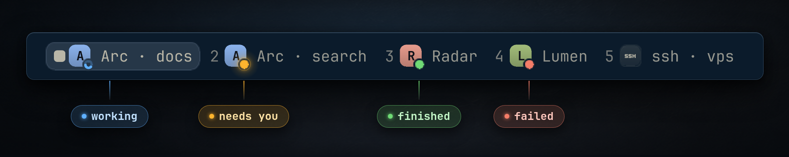
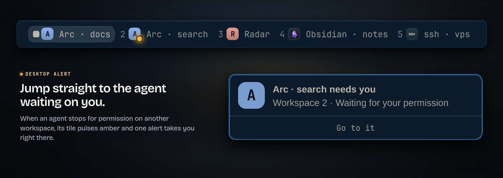
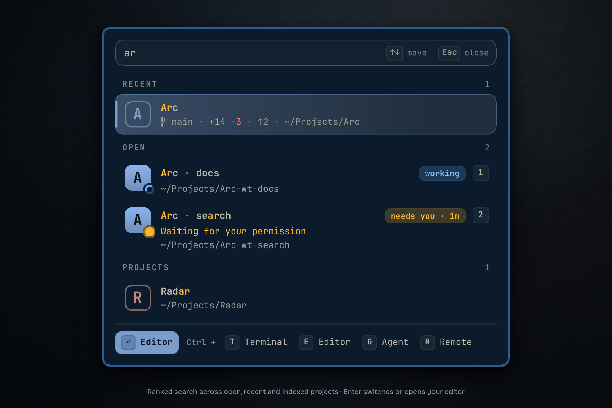

<h1 align="center">Signpost</h1>

<p align="center">
  Workspaces that name themselves, for <a href="https://omarchy.org">Omarchy</a>.<br>
  See what is on every workspace, and which AI agent needs you, right from your bar.
</p>

<p align="center">
  
  
  
  
</p>

<p align="center">
  
</p>

Signpost replaces Omarchy's workspace numbers with **number + tile + name**: the git repo in your terminal, the project an AI agent is working on, the ssh host, the local model or the web app. Plain terminals and browsers without a project keep their number and logo. When an agent stops to ask for permission, its tile pulses amber and an alert with a **Go to it** button jumps straight to that workspace.

## Highlights

- **Real names, nothing guessed.** Every name comes from an open folder, git repo, app, ssh host, local model or pin you set.
- **Agent status at a glance.** Claude Code works with no setup. Codex and OpenCode report through optional hooks; other agents show working and finished from CPU use.
- **Project switcher.** Middle-click the bar (or bind a key) to fuzzy-search open, recent and indexed projects (`~/Projects` + `zoxide`), focus a window or open your editor with Enter, or launch a terminal, editor or agent in one keystroke.
- **Terminal command status.** Long builds and test runs get a badge; an optional shell snippet adds pass and fail colour.
- **Theme-aware, local and light.** Tile colours come from your Omarchy theme. Everything runs locally in one Python file with no dependencies.

## Install

```sh
omarchy plugin add https://github.com/TammyX44/Signpost --enable
```

Signpost offers once to take the place of Omarchy's workspace numbers. Choose **Replace** (your bar is never changed without that click), then check that the engine is running:

```sh
omarchy-shell signpost status
# engine up · 6 workspaces · claude: agents view
```

### Update

```sh
omarchy plugin update io.github.tammyx44.signpost
```

### Uninstall

Remove any optional agent hooks first, put Omarchy's workspace widget back, then remove the plugin and its saved state:

```sh
p=~/.config/omarchy/plugins/io.github.tammyx44.signpost/signpost.py
python3 -I "$p" hooks remove                    # add --agent codex or --agent opencode if installed
python3 -I "$p" unswap                          # restores the workspace widget you had before
omarchy plugin remove io.github.tammyx44.signpost --yes
rm -rf ~/.local/state/signpost                  # pins, aliases, colours and recent projects
```

`unswap` tells you when there is nothing to undo. If you added the shell snippet for command status, remove it from your shell startup file too.

## Works with

| Category | Supported |
|---|---|
| **AI agents** | Claude Code (live, no setup + optional hook), Codex CLI (optional trusted hook), OpenCode 2.x (experimental plugin); CPU fallback for Gemini CLI, Aider, Goose, Crush, Amp, Cursor Agent, pi |
| **Terminals and tmux** | kitty (live), Alacritty, foot, Ghostty, WezTerm, GNOME Console, Konsole, and the active tmux pane |
| **Editors and agent apps** | Neovim, Vim, Helix, VS Code (live), Cursor, Zed, JetBrains, and T3 Code (live) |
| **Web apps, ssh, models** | Omarchy web apps in Chromium-based browsers (live: Brave), Figma, `ssh · host`, Ollama, `llama.cpp`, vLLM |

Items marked "live" were checked on the author's machine; the rest are covered by recorded fixtures in [`tests/`](tests). See [`docs/HOW-IT-WORKS.md`](docs/HOW-IT-WORKS.md) and [`docs/QA.md`](docs/QA.md).

## Using Signpost

| On a workspace | What happens |
|---|---|
| Left-click | Switch to it; on the focused workspace, cycle its layout like the stock widget |
| Middle-click | Toggle the project switcher on that monitor |
| Right-click | Pin a name, rename the project everywhere, reset a rename, or return to automatic |
| Hover | See what is open there and why it got its name |
| Scroll | Next or previous workspace |

### The badge and the alert

<p align="center">
  
</p>

- **Blue spinning arc**: an agent or terminal command is working.
- **Amber pulsing dot**: an agent needs you (pings every 2.5 s for 30 s, then every 10 s).
- **Green dot**: finished on a workspace you are not looking at. For terminal commands, green and red need the opt-in shell snippet; without it, a finished command shows a hollow grey ring so a failed build never looks green.
- **Desktop alert**: when a supported agent reports a permission request on another workspace, one notification offers a **Go to it** button. Alerts pause during screen sharing, and motion stops with `omarchy toggle animations`.

<p align="center">
  
</p>

### The project switcher

<p align="center">
  
</p>

Middle-click anywhere on Signpost in the bar, run `omarchy-shell signpost projects`, or bind `signpost.projects` in `~/.config/hypr/bindings.lua`. With an empty query, waiting projects sort to the top, followed by open, recent and indexed projects (from `projectRoots`, `~/Projects` by default, plus `zoxide` when installed). Typing ranks exact, word-start, fuzzy and substring hits across names, branches, paths and workspace keycaps (type `needs` or `wait` for waiting agents). Press <kbd>Enter</kbd> to focus an open window or open a closed project in your editor (`omarchy-launch-editor`), <kbd>Ctrl</kbd>+<kbd>T</kbd> for a terminal, <kbd>Ctrl</kbd>+<kbd>E</kbd> for your editor, <kbd>Ctrl</kbd>+<kbd>G</kbd> for an agent (`claude` by default), <kbd>Ctrl</kbd>+<kbd>R</kbd> for the `origin` remote (https only), and <kbd>Esc</kbd> to close.

See [`docs/SETTINGS.md`](docs/SETTINGS.md) for all `omarchy-shell signpost` commands, suggested keybindings, settings, 0.3 key migration, and custom rules or logos.

## Optional agent hooks

Claude Code works out of the box via `claude agents --json`. Optional hooks make Claude Code instant, add exact permission alerts for Codex CLI, and add experimental support for OpenCode 2.x. Each installer merges into your existing config and saves a backup:

```sh
p=~/.config/omarchy/plugins/io.github.tammyx44.signpost/signpost.py
python3 -I "$p" hooks status
python3 -I "$p" hooks install                   # add --agent codex or --agent opencode
```

See [`docs/AGENTS.md`](docs/AGENTS.md) for per-agent setup, opt-in terminal pass/fail snippets (`shell-init`), and opt-in unread counts.

## Privacy

Everything runs locally and nothing is sent anywhere. Files written by Signpost are readable by you only (folders `0700`, files `0600`). The switcher runs `git` only while open, with hooks, `core.fsmonitor`, external diff, textconv, filters and transports switched off (needs git 2.40+, or set `switcherGit` to `never`). Turn off `showQuestions` to keep prompt text out of alerts and UI; names and alerts hide automatically during screen sharing, including a share that was already running when Signpost started (this uses `pw-dump` from PipeWire). See [`docs/HOW-IT-WORKS.md`](docs/HOW-IT-WORKS.md) for the full file list and git safety details.

## Requirements

- Omarchy with its Quickshell bar and Hyprland's Lua config (checked on Omarchy 4.5 and Hyprland 0.57.2).
- `python3` 3.10+ (no Python packages) and `git` 2.40+ (for the switcher's git line).
- `busctl` and `gdbus` for alerts (shipped with Omarchy).
- Claude Code with `claude agents` for hook-free "needs you" (checked with 2.1.318).

Signpost installs no packages and never asks for elevated privileges.

## Documentation

- [`docs/SETTINGS.md`](docs/SETTINGS.md): settings reference, 0.3 key migration, commands, keybindings, custom rules and logos
- [`docs/AGENTS.md`](docs/AGENTS.md): Claude Code, Codex and OpenCode hooks, terminal command status, unread counts
- [`docs/HOW-IT-WORKS.md`](docs/HOW-IT-WORKS.md): naming order, tiles and colours, engine details, privacy, files written, known limits, development
- [`docs/QA.md`](docs/QA.md): release QA checklist

## License

[MIT](LICENSE). The bundled Claude, OpenAI and Ollama logos are listed in [`assets/icons/ATTRIBUTION.md`](assets/icons/ATTRIBUTION.md); they belong to their owners and are used only to identify the program running in a workspace.
